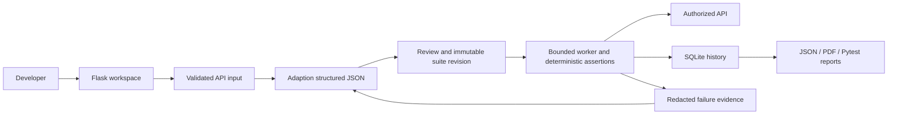

# TestPilot AI

A local, single-user API testing workspace built with Flask, Adaption AI, Pydantic and SQLite.

**Describe → Generate → Review → Execute → Analyse → Report.**

## Project overview

TestPilot AI turns an API description or OpenAPI document into reviewable,
structured test cases and then executes those cases against an authorized API.
It is designed to make API contract checking practical for developers and QA
teams without pretending that AI-generated expectations are authoritative.

### Problem

API tests are often written late, maintained manually, and disconnected from
the API contract. This makes negative cases, boundary behavior, security
checks, and useful failure evidence easy to miss.

### Solution

The application combines Adaption AI for structured test-design assistance with
a deterministic assertion engine for real HTTP evidence. AI output is
validated, reviewed, and converted into controlled templates; AI-generated
Python is never executed.

AI returns structured test data. A fixed assertion engine sends real HTTP requests in a separate Python process. The application never runs AI-generated code, invents execution outcomes, or counts skipped tests as passes.

## Install and start

Python 3.11 or later is required. Development and verification use the existing Python 3.13 `venv`.

```powershell
# Only if you do not already have a virtual environment:
python -m venv venv

.\venv\Scripts\python.exe -m pip install -r requirements.txt

# Only if .env does not already exist. Preserve an existing configured file.
Copy-Item .env.example .env
# Edit .env locally and set ADAPTION_API_KEY.

.\venv\Scripts\python.exe app.py
```

Open **http://127.0.0.1:5000**. Debug mode is disabled. Keep the server bound to loopback.

No API key is needed to create, review, run or export manual suites. Adaption is required for AI generation and AI failure analysis. The default provider remains Adaption and the model remains `qwen3.5-397b`.

## Architecture



Adaption is used for test design and evidence-based failure hypotheses.
Pydantic validates provider responses, while the execution engine determines
pass/fail from actual HTTP responses.

## Workflow

1. **New API test:** enter a name, method, endpoint and expected behaviour. Optional inputs include headers, query parameters, JSON/form bodies and an OpenAPI JSON/YAML file.
2. **Generate:** Adaption receives the redacted description and contract plus the versioned JSON schema. The documented streaming API avoids large-response gateway timeouts; only completed output text is retained. Every response is validated. One invalid-output repair attempt is allowed; malformed output is never saved. Generation can take several minutes.
3. **Review:** inspect assumptions, clarification questions, requests and assertions. Use **Edit** for a case or **Edit suite JSON** to add/remove cases. All edits are validated. Set unknown status codes and `eligible` only from the real API contract. Save a reviewed revision to enable execution and Pytest export.
4. **Execute:** supply the authorized target origin, temporary secrets and optional shared headers. Confirm permission to test. Write requests may change target data. The API origin must match all absolute test endpoints.
5. **Inspect:** results distinguish passed, failed, skipped and execution-error outcomes. Each includes expected vs actual values, assertion failures and measured latency. Missing secrets and ineligible cases are skipped.
6. **Analyse:** send redacted failed-run evidence to Adaption. Its suggested causes are explicitly unconfirmed hypotheses. Runs without failures receive a deterministic summary without an AI call.
7. **Export:** download JSON or PDF from results, history/reports, or standalone Pytest from a reviewed suite.

Unknown API behaviour is not a contract. AI can make mistakes even with schema validation: review is mandatory. SQL/XSS scenarios check the stated API behaviour; passing them is not proof that an API is secure. Rate-limit checks use at most three requests per case and cannot establish resistance to brute force or load.

## Controlled local demonstration

```powershell
.\venv\Scripts\python.exe demo.py
```

Open **http://127.0.0.1:5001**. This launches a real local mock API on **http://127.0.0.1:8765** and uses a separate `instance/demo.sqlite3` history. Only that exact loopback origin is allowed in the demo workspace. The normal application remains private-network blocked.

The fixture implements:

| Request | Documented behaviour |
| --- | --- |
| `GET /health` | 200, JSON `{"status":"ok","version":"1.0"}` |
| `POST /echo`, JSON `{"name":"Ada"}` | 201, JSON `{"name":"Ada"}` |
| `POST /echo` with missing, empty or non-string name | 400, JSON error |
| `GET /private`, `Authorization: Bearer demo-token` | 200, JSON user object |
| `GET /private` without that synthetic token | 401, JSON error |
| Unknown GET path | 404, JSON error |

Import `examples/health.openapi.yaml`, or describe `/health`. For an offline demonstration choose **Create manually**, edit its expected status to 200 and `eligible` to true, then save and execute against the fixture. To demonstrate a genuine failure, duplicate a case with a new ID, label it as an intentional mismatch, and expect 201 from `/health`. That request actually returns 200, so the assertion fails. Keep a third case ineligible to demonstrate a skip.

The synthetic `demo-token` is only a local fixture constant, not a service credential. Demo records are generated by real requests, never seeded statistics.

## Three-minute demonstration script

1. **Problem (20 seconds):** Explain that API teams need broad, reviewable
   coverage but manual test authoring is slow and often loses contract context.
2. **Describe (30 seconds):** Open **New API test**, enter the health endpoint
   or import `examples/health.openapi.yaml`, and show request/contract inputs.
3. **Generate (40 seconds):** Generate with Adaption and show structured
   categories, assumptions, expected statuses, and eligibility.
4. **Review (30 seconds):** Open a case, edit an expectation if needed, and
   save the reviewed immutable revision.
5. **Execute (45 seconds):** Run against the controlled local fixture with
   authorization confirmed. Point out that the worker makes real bounded HTTP
   requests and records actual response data.
6. **Analyse and report (35 seconds):** Demonstrate a deliberate status mismatch,
   show the failed assertion and unconfirmed AI hypotheses, then download JSON,
   PDF, or standalone Pytest.
7. **Close (20 seconds):** Show the dashboard totals and explain that skipped
   tests are not counted as passes and credentials are not persisted.

Recommended genuine screens to capture: Overview, New API test, Suite review,
Results & analysis, and the Reports page. Capture them from the running local
application after completing the controlled demo; do not use seeded screenshots.

## Credentials

Use placeholders in the saved suite:

```json
{"headers":{"Authorization":"Bearer ${SECRET_TOKEN}"},"body":{"password":"${SECRET_PASSWORD}"}}
```

Supply the values in **Execution secrets**:

```json
{"SECRET_TOKEN":"temporary-value","SECRET_PASSWORD":"temporary-value"}
```

These values travel to the fixed worker through stdin, not command-line arguments or temporary files. They are not saved to SQLite. Named sensitive string fields are replaced with placeholders before persistence; known runtime values and sensitive response fields are redacted from stored evidence. Set-Cookie and non-allowlisted response headers are omitted. Non-JSON bodies are not retained, and JSON previews above 12 KB are omitted after assertions run.

Use `request.auth_mode: "omit"` for missing/invalid-auth cases so shared runtime headers are not inherited. An explicit header in an individual case overrides a shared header of the same name.

Redaction cannot identify every secret hidden in arbitrary prose, unusual field names or encoded content. Do not paste credentials, production personal data, or confidential payloads into free-text descriptions. Use dedicated secret placeholders and test accounts. Local database files contain redacted API configurations and evidence; protect them and their backups as application data.

## Configuration

| Variable | Default | Purpose |
| --- | --- | --- |
| `ADAPTION_API_KEY` | none | Existing Adaption credential; read locally, never displayed |
| `ADAPTION_MODEL` | `qwen3.5-397b` | Adaption model identifier |
| `TESTPILOT_AI_TIMEOUT` | `150` | AI stream deadline in seconds; idle reads time out within 45 seconds |
| `TESTPILOT_PORT` | `5000` | Local Flask listening port |
| `TESTPILOT_SESSION_KEY` | random per start | Optional stable, long random browser-session signing key |
| `TESTPILOT_LOCAL_ORIGINS` | empty | Comma-separated exact loopback fixture origins; operator-only |

Never expose the `.env` file or commit it. The `.gitignore` also excludes virtual environments, databases, generated reports, exports and temporary files. Restart the app after changing configuration. The app can start with no AI key; generation then gives a clear configuration error.

## Executable Pytest exports

Exports are self-contained Python files generated from fixed application source and validated JSON data. They use the standard-library HTTP client so the exported file preserves the application's DNS pinning and redirect policy without a second transport implementation. `requests` is included for integration tooling, not used to bypass the transport safeguards.

```powershell
$env:TESTPILOT_BASE_URL = 'https://api.example.com'
$env:TESTPILOT_AUTHORIZED = '1'
# Optional temporary values, available to this shell and its child processes:
$env:TESTPILOT_SECRETS = '{"SECRET_TOKEN":"temporary-value"}'
.\venv\Scripts\python.exe -m pytest .\test_suite_2.py -v
Remove-Item Env:TESTPILOT_SECRETS -ErrorAction SilentlyContinue
```

For the controlled demo only, use `TESTPILOT_BASE_URL=http://127.0.0.1:8765` and `TESTPILOT_LOCAL_ORIGINS=http://127.0.0.1:8765`. Never run exported tests in parallel against a target. Exported scripts run in the invoking process, so the application's parent worker deadline and POSIX resource limits do not apply; the same HTTP limits do apply. Keep CI job timeouts enabled.

## Tests and quality checks

```powershell
.\venv\Scripts\python.exe -m pytest -q
.\venv\Scripts\python.exe -m pip check
node --check static/script.js

# Explicit live provider verification; uses your account and may incur charges:
.\venv\Scripts\python.exe test_adaption.py
```

Normal Pytest runs use mocked AI responses, temporary SQLite databases and a controlled HTTP server on an ephemeral loopback port. They require no paid AI requests. The fixture integration tests exercise the real isolated worker, assertion failures, timeouts, size limits, redirects, body formats, redaction, reports and standalone generated tests. The live smoke test is safe to import and is excluded from normal collection.

## Architecture

| Location | Responsibility |
| --- | --- |
| `app.py`, `config.py` | Flask factory, local security, routes and configuration |
| `models/schemas.py` | Closed Pydantic contract for input, suites, rules and runs |
| `models/database.py` | SQLite repository and schema migration v1 |
| `services/ai_service.py`, `services/prompts/` | Adaption generation, validation, repair and evidence analysis |
| `services/openapi_service.py` | Bounded JSON/YAML OpenAPI import |
| `services/network.py` | DNS validation, numeric-IP connection pinning, TLS hostname validation |
| `services/engine.py`, `worker.py`, `test_executor.py` | Deterministic assertions and bounded separate-process execution |
| `services/redaction.py` | Secret placeholders, substitutions and redaction |
| `services/test_generator.py`, `report_service.py` | Standalone Pytest, JSON and PDF output |
| `templates/index.html`, `static/` | Responsive single-page workspace with hash navigation |
| `tests/`, `examples/`, `demo.py` | Automated verification and reproducible local demonstration |

No ORM or frontend build system is needed. SQLite uses parameterized statements, foreign keys and WAL mode. Projects store redacted configuration; suites and cases are versioned; each run points to its immutable suite. Runs retain outcomes and AI analysis; export metadata is stored separately. Dashboard totals come from SQL aggregates. `generated_cases` counts AI generation only; reviewed revisions are counted separately. Lists show the latest 100 records; totals cover all records. Activity shows the latest 14 days containing runs, with UTC dates.

`PRAGMA user_version=1` initializes the schema transactionally. Later migrations must increment it; newer unsupported database versions are rejected. Back up the database using SQLite's backup API or stop the app before copying the database and any WAL files.

## Security model and limits

- HTTP(S) only. Embedded URL credentials, query strings in endpoints, unsafe headers and cross-origin test endpoints are rejected. Supply query parameters separately.
- All resolved addresses must be globally routable. Loopback, private, link-local, reserved, multicast, metadata and IPv6 transition destinations are blocked. A mixed public/private DNS answer is rejected.
- A socket connects directly to the validated numeric IP. HTTPS still verifies the original hostname and certificate. Each request/repetition resolves and validates again. No environment proxies, redirects, implicit cookies or remote OpenAPI references are used.
- Maximum 25 cases, three repetitions per case, sequential requests, a 1–15 second request timeout, 256 KB response limit and a 90-second isolated-worker deadline. Requests do not follow redirects; tests can assert the returned redirect status.
- Worker environments exclude API keys and proxy settings. POSIX adds CPU, address-space, descriptor and output-file limits. Windows uses process deadlines and bounded work, not a full OS sandbox.
- AI source code is never executed. Exported data is safely quoted into trusted templates. Responses and AI text are rendered with DOM text nodes, not HTML.
- Browser writes require a session CSRF token. Same-origin checks, trusted local hosts, CSP, no-store caching, HttpOnly cookies and SameSite=Strict protect the local UI.

This is **not an internet-facing, multi-tenant production deployment**. It has no user accounts or tenant isolation. Deployments need authentication, HTTPS, restrictive egress, a shared job queue/concurrency control, operational monitoring, backups and stronger worker isolation. The current run/AI locks are per process; use one application process. A killed worker reports unknown outcomes as errors because some requests may already have reached the target. An application crash mid-run may leave a record marked running; it must not be interpreted as success.

Additional limitations: no binary file upload, OAuth refresh flow, chained response-variable extraction, load testing, WebSocket testing, external OpenAPI references, or general JSON Schema response validation. Assertions support named JSON paths, required fields, equality/types/numeric bounds, exact headers/content type and latency. OpenAPI is supplied as context to AI; the application does not claim full specification conformance validation. PDF fonts support common Latin text; non-Latin reports may require configuring an appropriate font.

## References and development record

- [Adaption Python response creation](https://docs.adaptionlabs.ai/api/python/resources/responses/methods/create)
- [OWASP SSRF prevention](https://cheatsheetseries.owasp.org/cheatsheets/Server_Side_Request_Forgery_Prevention_Cheat_Sheet.html)
- See `DEVELOPMENT_LOG.md` for audit findings, verification results and remaining deployment limitations.

## Credits and acknowledgement

TestPilot AI uses the Adaption Python SDK for model access, Flask for the local
web application, Pydantic for structured validation, SQLite for persistence,
Pytest for verification, and ReportLab for PDF reports.
